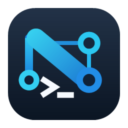

<p align="center">
  
</p>

<h1 align="center">NetOps Terminal</h1>

<p align="center">
  A Windows terminal workspace for the devices you manage every day.
  <br>
  Keep your inventory, connections, and local shells within reach.
</p>

<p align="center">
  <strong>Windows 10/11 x64</strong> &nbsp;·&nbsp; <strong>Version 1.1.2</strong> &nbsp;·&nbsp; <strong>.NET 10</strong>
</p>

<p align="center">
  <a href="https://github.com/skadooooooooooosh/NetOps-Terminal/releases/tag/v1.1.2"><strong>Download v1.1.2</strong></a>
  &nbsp;·&nbsp;
  <a href="docs/user-guide/NETOPS_TERMINAL_USER_GUIDE.md">User guide</a>
  &nbsp;·&nbsp;
  <a href="CHANGELOG.md">What's new</a>
  &nbsp;·&nbsp;
  <a href="SECURITY.md">Security</a>
</p>

---

## At a glance

| Connect | Organize | Work |
| --- | --- | --- |
| SSH, Telnet, Serial / COM, Raw TCP, PowerShell, and Command Prompt | Saved devices, site folders, Favorites, Recent, and credential profiles | Tabs, split panes, terminal search, Input Lock, reconnect, and optional output logging |

Saved devices can open a **CLI session**, an **external web interface**, or **both**. For devices with both, choose what a double-click opens; the other action stays available from the device menu.

### Built for a real device list

- Move devices between sites and folders, select several devices at once, and set your own order in Device Explorer.
- Keep multiple connection attempts visible in separate tabs and drag tabs into the order you want.
- Import devices from Excel, JSON, or CSV; export device metadata to Excel or JSON. Exports leave out passwords and trusted host keys.
- Use Quick Connect for a one-off session or save a device for later.
- Work in a consistent graphite interface with compact sidebar icons, clear status colors, and matching dialogs. Device Explorer opens over the workspace without resizing the terminal.

## Get the app

1. Open the [v1.1.2 release](https://github.com/skadooooooooooosh/NetOps-Terminal/releases/tag/v1.1.2) and expand **Assets**.
2. Download the [Windows x64 MSI](https://github.com/skadooooooooooosh/NetOps-Terminal/releases/download/v1.1.2/NetOpsTerminal-1.1.2-win-x64.msi) and its [SHA-256 checksum](https://github.com/skadooooooooooosh/NetOps-Terminal/releases/download/v1.1.2/NetOpsTerminal-1.1.2-win-x64.msi.sha256).
3. Check the hash, close NetOps Terminal if it is running, then run the installer.

The installer includes the .NET runtime. It defaults to `C:\Program Files\NetOps Terminal`, asks for administrator approval, and offers Desktop and Start menu shortcuts. The [portable ZIP](https://github.com/skadooooooooooosh/NetOps-Terminal/releases/download/v1.1.2/NetOpsTerminal-1.1.2-win-x64.zip) is available on the same release page. The packages are unsigned, so Windows may show a publisher warning. GitHub sign-in and repository access are required while this repository is private.

> **Upgrading from 1.1.0 or 1.1.1?** Close the app, then run the 1.1.2 MSI. It upgrades the 1.1.0 and 1.1.1 all-users installations. Back up user data before upgrading.

> **Upgrading from 1.0.0?** Back up `%LOCALAPPDATA%\NetOpsTerminal` for each Windows account before installing 1.1.2. The saved-device database migration is forward-only; 1.0.0 cannot read the upgraded database. Saved passwords are held separately in Windows Credential Manager. See the [1.1.2 release guide](docs/RELEASE_V1_1_2.md) for upgrade details.

## Connections and safety

| Connection | What to expect |
| --- | --- |
| **SSH** | SHA-256 host-key verification. Unknown keys need your approval; changed keys need explicit review before replacement. |
| **Telnet / Raw TCP** | Plaintext connections. Use only on authorized, trusted networks. |
| **Serial / COM** | Direct access to a local serial port. |
| **PowerShell / Command Prompt** | Local Windows shells, available from the sidebar. |
| **Web interface** | Opens the saved HTTP or HTTPS address in an external browser. An optional access check tests port reachability only. |

Reusable SSH passwords are protected by Windows Credential Manager. Device and workspace metadata stays in a local SQLite database; trusted SSH keys are kept in the app's `known_hosts` file. Session output is saved only if you turn on logging. See [Security](SECURITY.md) for the storage locations and other details.

## Build from source

Use Windows 10/11 x64 and the .NET 10 SDK pinned in [`global.json`](global.json).

```powershell
dotnet restore
dotnet build
dotnet build -c Release
dotnet test
dotnet run --project src/NetOpsTerminal.App/NetOpsTerminal.App.csproj
```

To build the self-contained MSI and ZIP:

```powershell
powershell.exe -NoProfile -ExecutionPolicy Bypass -File .\tools\Publish-Msi.ps1
```

The release files are written to the ignored `artifacts\release` directory.

## Project notes

- [User guide (Markdown)](docs/user-guide/NETOPS_TERMINAL_USER_GUIDE.md) and [printable PDF](docs/user-guide/NETOPS_TERMINAL_USER_GUIDE.pdf) — installation, illustrated workflows, shortcuts, and troubleshooting
- [Changelog](CHANGELOG.md) — changes by version
- [Release guide](docs/RELEASE_V1_1_2.md) — installation, upgrade, and package details
- [Security](SECURITY.md) — credentials, host keys, local data, and vulnerability reporting
- [Third-party notices](THIRD_PARTY_NOTICES.md) — bundled dependency notices

SSH private-key and SSH-agent authentication are not part of version 1.1.2.
