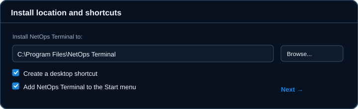
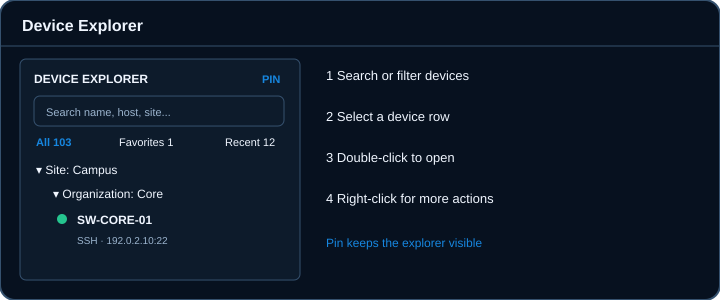
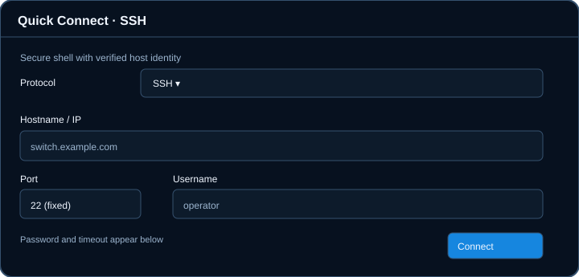
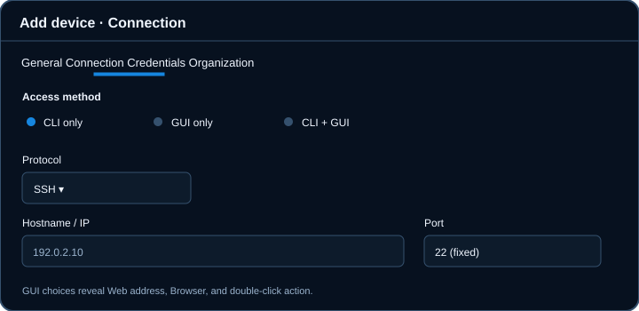
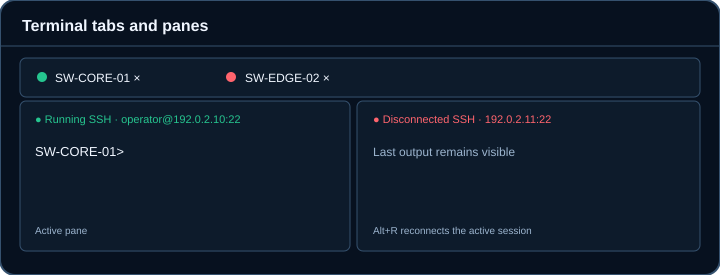
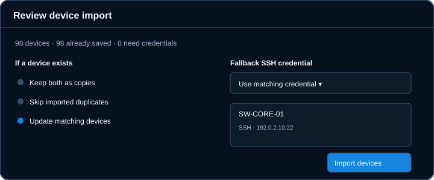

# NetOps Terminal 1.1.0 User Guide

A practical guide for Windows users who connect to network devices, organize a device list, and work in terminal sessions.

> **About the pictures:** These are labeled illustrations of the version 1.1.0 controls, not screenshots of a real device or network. Example names and addresses are fictional. The installed app may differ slightly with window size.

## Contents

1. [Install and start](#1-install-and-start)
2. [Find your way around](#2-find-your-way-around)
3. [Connect once with Quick Connect](#3-connect-once-with-quick-connect)
4. [Save a device and credentials](#4-save-a-device-and-credentials)
5. [Open a device's web interface](#5-open-a-devices-web-interface)
6. [Organize devices](#6-organize-devices)
7. [Use terminal tabs and panes](#7-use-terminal-tabs-and-panes)
8. [Import and export devices](#8-import-and-export-devices)
9. [Settings and local data](#9-settings-and-local-data)
10. [Fix common problems](#10-fix-common-problems)
11. [Keyboard shortcuts](#11-keyboard-shortcuts)

## 1. Install and start

NetOps Terminal 1.1.0 runs on Windows 10/11 x64. The installer includes the .NET runtime.

1. Open the [v1.1.0 release](https://github.com/skadooooooooooosh/NetOps-Terminal/releases/tag/v1.1.0). If the repository is private, sign in to an account with access.
2. Download **NetOpsTerminal-1.1.0-win-x64.msi** and its `.sha256` file from **Assets**. Verify the downloaded file if your organization requires a checksum check.
3. Close any running NetOps Terminal window, then run the MSI. Approve the Windows administrator prompt.
4. Read and accept the software agreement. The default installation folder is `C:\Program Files\NetOps Terminal`; use **Browse** if you need another location.
5. Keep or clear the separate **Create a desktop shortcut** and **Add NetOps Terminal to the Start menu** checkboxes, then finish the wizard.
6. Open **NetOps Terminal** from Start or your Desktop shortcut.

The installer is unsigned, so Windows may display a publisher warning. Obtain the package from the intended release and verify its checksum before proceeding. The optional portable ZIP is on the same release page. There is no automatic updater.

**Upgrading from 1.0.0:** Back up `%LOCALAPPDATA%\NetOpsTerminal` for each Windows account before launching 1.1.0. The device database upgrade is forward only: 1.0.0 cannot read the upgraded database. Saved passwords are held separately in Windows Credential Manager. See the [release guide](../RELEASE_V1_1.md).

## 2. Find your way around

The left rail opens Device Explorer, Quick Connect, Add device, local shells, Credentials, Import, Export, and Settings. Hover over a rail icon to see its name. The **?** button in the title bar opens Help & Shortcuts. Device Explorer contains a search box, **All**, **Favorites**, and **Recent** filters, sites, organization folders, and device rows.

The small text below a device name shows its protocol and endpoint. **WEB** means web only; **CLI+WEB** means both access methods. Environment badges use short labels such as **PROD**, **TEST**, **LAB**, and **DEV**. The pin keeps Device Explorer open while you work. When unpinned, the explorer may close after a successful connection or opening a local shell; sites and folders retain the expanded or collapsed state you chose.

Select a device to use the **Connect** or **Open web interface** action shown for that device. Double-click uses the saved default action. Right-click a device for its other available actions.

## 3. Connect once with Quick Connect

Use **Quick Connect** on the left rail, or press **Ctrl+N**, when you need a session without saving a device.

1. Choose **SSH**, **Telnet**, **Serial**, or **Raw TCP**.
2. Fill in the fields shown for that protocol. SSH uses port **22** and Telnet uses port **23**; these fields are fixed in version 1.1.0. Raw TCP uses a configurable port. Serial uses a local COM port and serial settings.
3. For SSH, enter the hostname or IP, username, password, and timeout; click **Connect**. The Quick Connect password is kept only for that terminal tab.
4. For Telnet, read and select **I understand this Telnet session is plaintext** before connecting. Telnet sends credentials and output without encryption.

On the first SSH connection to a host, inspect the displayed SHA256 host-key fingerprint and confirm it against a trusted source before accepting it. A changed saved key shows a separate warning. Verify the new fingerprint independently before using **Replace saved key**. The app never silently replaces a changed key.

If an older SSH device ignores Backspace, try **Standard**, then **Compatibility: BS (Ctrl+H)**, then **Compatibility: DEL** in the Quick Connect or saved-device connection options. Press the Backspace key normally after changing the setting.

## 4. Save a device and credentials

Use **Add device** on the left rail for an entry you will reuse. The editor has **General**, **Connection**, **Credentials**, and **Organization** tabs.

1. On **General**, enter a device name. Optionally add description, device type, environment, Favorites status, and notes.
2. On **Connection**, choose **CLI only**, **GUI only**, or **CLI + GUI**. For CLI access, choose a protocol and complete its fields. SSH is fixed to port 22 and Telnet to port 23.
3. For SSH, open **Credentials** and choose a reusable credential profile. Create one from **Credential Profiles** on the rail if needed. You can leave **Username override** blank to use the profile username.
4. On **Organization**, enter a **Site** and, if useful, one **Organization folder** under it. Click **Save device**.

Credential profile passwords are protected by Windows Credential Manager. A saved device refers to its profile; the password is not stored in the device database. **GUI only** does not need an SSH credential. Existing devices can be edited from Device Explorer. Changing a CLI device from SSH to Telnet also requires the Telnet plaintext acknowledgment.

### Connection choices

| Access method | What appears in the editor | What opening does |
| --- | --- | --- |
| CLI only | Protocol and terminal settings | Opens a terminal session |
| GUI only | Web address and browser | Opens the external browser |
| CLI + GUI | Both sets of settings | Uses your selected double-click action; both remain in the device menu |

## 5. Open a device's web interface

For **GUI only** or **CLI + GUI**, enter the device's full `http://` or `https://` address in **Web address**. Choose **Windows default browser**, **Microsoft Edge**, or **Google Chrome**. On a device with both methods, set **Open on double-click** to **CLI terminal** or **Web GUI**.

Click **Check access** only if you want to test whether the web port responds. This check does not prove the web page is the right device, validate a TLS certificate, or sign in. Web sign-in stays in your external browser. Prefer HTTPS where the device supports it.

In Device Explorer, double-click a web device or use **Open web interface** from its menu. For a dual-access device, use the menu to open the other method when needed.

## 6. Organize devices

Device Explorer supports **Site → Organization folder → devices**. Devices may also sit directly under a site or **Unassigned**. The explorer starts in alphabetical order until you set a custom order.

- Right-click inside Device Explorer and choose **New site**. To create an Organization folder, select a site or a row within it, right-click, and choose **New Organization folder**.
- Drag a device with the left mouse button onto a site or Organization folder to move it. Its saved Site and Organization values update. You can also edit those fields directly on the device's **Organization** tab.
- Hold **Ctrl** or **Shift** to select several device rows, then drag a selected row onto a site or folder to move the selection together. Review the selected rows before dropping.
- Drag a device above or below another device to set a custom order. A blue insertion line shows the destination. Sites and sibling folders can also be reordered.
- To return one site's or folder's direct children to alphabetical order, select that row, right-click, and choose **Sort alphabetically**.
- Use **All**, **Favorites**, **Recent**, and the search field to narrow the list. For moving or ordering rows, return to **All** and clear the search.
- To delete one or several selected devices, select them, use the delete action, and check the count in the confirmation dialog. Deleting a nonempty site or folder is refused until its devices are moved or deleted.

A site is the first level and an Organization folder is the second; the editor does not create deeper folder paths.

## 7. Use terminal tabs and panes

Each connection opens its own terminal tab, including a tab while the connection is still in progress. This lets you see and cancel an individual attempt. Click a tab to make it active; drag its label left or right to reorder it. The tab and selected-session status dots use green for running and red for disconnected sessions. A connecting tab has its own connecting state.

Open **PowerShell** or **Command Prompt** from the left rail for a local shell. For the active terminal, use **Alt+Right** to split right or **Alt+Down** to split below. Use **F6** and **Shift+F6** to move focus between panes, and **Ctrl+W** to close the active pane. The tab's **×** closes that tab.

Use **Ctrl+F** to search terminal output. **Alt+L** toggles Input Lock; while locked, the terminal continues to display output but blocks typing and paste. **Alt+G** turns output logging on or off for the active session. **Alt+R** reconnects, and **Alt+X** disconnects. Review the active tab before invoking a session shortcut. A multiline or control-sequence paste opens a confirmation dialog so you can review it first.

## 8. Import and export devices

Use **Import devices** on the left rail for an Excel workbook, CSV, or JSON device file. A blank Excel import template is available from **Settings**. The template has a **Devices** sheet with dropdowns for accepted values, including Device Type, Protocol, Access Mode, Browser Preference, and Default Open Action, and an **Instructions** sheet.

1. Complete **Name** and **Host** for each row. Use the template's dropdowns for other fields. For Telnet, explicitly set **Protocol = Telnet**, **Port = 23**, and the Telnet acknowledgment. SSH uses port 22 and does not need the Telnet acknowledgment.
2. Import the file and inspect **Review device import** before proceeding. The list shows each device's protocol and endpoint.
3. Choose **Keep both as copies**, **Skip imported duplicates**, or **Update matching devices**. Select a **Fallback SSH credential** if imported SSH devices need one; matching saved credentials may already be used.
4. Click **Import devices** and read the added, updated, skipped, and credential-required counts.

For a second import that changes existing device metadata, use **Update matching devices**. A port number alone does not change the protocol: set the Protocol column explicitly. Rows with an SSH port other than 22 or a Telnet port other than 23 are rejected. Imported passwords and trusted host keys are never accepted from a file.

Use **Export devices** to create a JSON device file or Excel workbook. Choose the export scope and whether to include Favorites and Recent metadata. Exported files contain device metadata, including saved web addresses; they exclude passwords, private keys, credential secrets, and trusted host keys. Check exported data before sharing it because names, hosts, sites, notes, and web addresses may identify your infrastructure.

## 9. Settings and local data

Open **Settings** from the bottom of the left rail to adjust terminal appearance and behavior, find the import template, and open the logs folder. The application uses a permanent dark theme. Settings and device data are local to each Windows account.

| Data | Location or owner |
| --- | --- |
| Saved devices and workspace metadata | `%LOCALAPPDATA%\NetOpsTerminal\data\netops-terminal.db` |
| Non-secret preferences | `%LOCALAPPDATA%\NetOpsTerminal\settings.json` |
| Saved SSH passwords | Windows Credential Manager |
| Trusted SSH host keys | `%LOCALAPPDATA%\NetOpsTerminal\ssh\known_hosts` |
| Optional session output logs | `%LOCALAPPDATA%\NetOpsTerminal\session-logs` |

Session logging is opt in. Remote devices can echo passwords or other sensitive text, so protect log files and review them before sharing. Workspace restore brings back disconnected tabs; it does not automatically reconnect to devices.

## 10. Fix common problems

| What you see | What to check |
| --- | --- |
| SSH host key is unknown | Compare the shown SHA256 fingerprint with a trusted source, then choose whether to trust it. |
| SSH host key changed | Verify the new fingerprint independently. Only then use **Replace saved key**. If unexpected, stop and ask your network administrator. |
| SSH handshake fails | Confirm SSH is enabled on the device and its firmware supports compatible algorithms. Older devices may need a vendor firmware update. Review sanitized technical details without sharing credentials. |
| SSH selected but port shows 23 | Edit and save the device; version 1.1.0 fixes SSH to 22 and Telnet to 23. In an import file, set Protocol explicitly. |
| Backspace does nothing | In connection options, try **Compatibility: BS (Ctrl+H)**, then **Compatibility: DEL**; press Backspace normally. |
| Imported SSH device needs credentials | Assign an existing credential profile or choose a fallback SSH credential during review. |
| Web page does not open | Check the saved URL, browser selection, local network access, and device web service. **Check access** tests only whether the port responds. |
| Desktop shortcut is missing | Check whether the installer checkbox was selected and whether Windows **Show desktop icons** is enabled. The Start menu shortcut is a separate option. |
| Explorer seems to disappear | Click the Device Explorer rail icon, or pin the explorer to keep it open during connections. Your folder expansion choices remain. |

If a connection fails, the **Details** button shows sanitized technical information. Include the error category, protocol, and device model when asking for support, but remove real IPs, usernames, and other sensitive values before sharing a report. Support: **lansangan888@gmail.com**.

## 11. Keyboard shortcuts

Open the in-app **? Help & Shortcuts** flyout for the authoritative list in your installed build.

| Action | Shortcut | Action | Shortcut |
| --- | --- | --- | --- |
| Quick Connect | Ctrl+N | Reconnect active session | Alt+R |
| Start/stop logging | Alt+G | Lock/unlock input | Alt+L |
| Disconnect | Alt+X | Find output | Ctrl+F |
| Split right | Alt+Right | Split down | Alt+Down |
| Close active pane | Ctrl+W | Next pane | F6 |
| Previous pane | Shift+F6 | Open PowerShell | Alt+P |
| Open Command Prompt | Alt+C | Open Help | Ctrl+/ |
| Close Help | Esc | | |

---

**Version:** 1.1.0 · **Publisher:** skadooooooooooosh · **Platform:** Windows 10/11 x64
